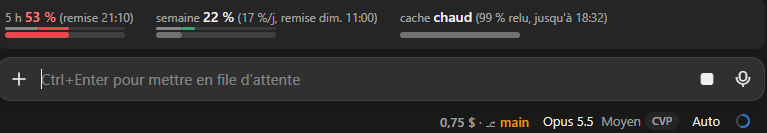

# sonar

*[English version](README.md)*

Un **mod** Claude Code qui donne à **l'onglet Code de Claude Desktop** ce que la *status line* montre dans le terminal —
**sans dépenser un seul token** : il lit les chiffres que le moteur a déjà et lance `git status` en local.

Il ne répète pas ce que Claude Code affiche déjà (remplissage du contexte, pourcentage des 5 h) et ne montre que ce qui
mérite un coup d'œil. Trois niveaux de lecture :

**Le pied** de la zone de saisie (toujours affiché), entre le mode de permission et le nom du modèle. Court (l'appli coupe un
pied trop long par « … ») :

```
🔥 2,40 $ · ⎇ master
```

Dans cet ordre, séparés par « · », chacun seulement s'il est connu :

1. l'état du cache collé au coût de la session : 🔥 chaud, ❄️ froid (orange, la prochaine réponse réécrira tout le cache),
   ❔ incertain (orange), puis le montant ; avec le bandeau, le cache y passe et le pied n'a plus que le montant ;
2. la branche (`⎇`), raccourcie : dernier segment après « / », sans suffixe d'empreinte, 20 caractères au plus
   (`claude/mod-pied-cache-79d924` → `mod-pied-cache`) ; orange sur une branche protégée ; `détachée` pour une tête détachée.

Les limites (5 h, semaine) n'y sont jamais, même en alerte : elles sont dans le bandeau, le panneau et `/sonar`.
Une seule couleur d'alerte au pied, l'orange, sur la valeur (le rouge est réservé au bandeau et au panneau).

**Le bandeau** (`/sonar bandeau`, en option, en plus du pied) au-dessus de la saisie : une barre par fenêtre et pour le cache, à la même hauteur,
chacune dans sa colonne, sur toute la largeur du bandeau (elles passent à la ligne si la fenêtre est étroite). Pour un
quota, la barre est bleue jusqu'où usage et temps concordent, puis colorée jusqu'au plus avancé des deux : verte quand le
temps est devant (de la marge), orange quand l'usage est devant (vous consommez plus vite que le rythme régulier), rouge si,
en plus, le quota est en alerte. Un relevé gardé d'une autre session est dessiné pâle, l'usage seul, en bleu. La barre du cache
montre le temps qui lui reste, en orange sanguin, et passe au bleu sur les 20 derniers % de sa durée de vie (bientôt
froid). La barre suit le temps réellement écoulé ; la couleur de la valeur
accorde une marge en début de fenêtre (1 h sur 5 h, 1 jour sur 7) et tient compte des seuils absolus (70 % et 90 % par défaut).
Branche et coût restent au pied.



*Ci-dessus : 53 % des 5 h consommés pour un peu plus d'un quart de la fenêtre écoulé, plus de 15 points d'avance → rouge
(au-delà de 5 points, ce serait orange). Au pied, `main` en orange : branche protégée.*

**Le panneau** (`/sonar`) : tout le détail, jauges comprises, avec les heures de remise à zéro, le budget par jour, le taux
de lecture du cache, la branche et les fichiers modifiés, le coût et le fichier des relevés. Il se ferme par sa croix.
Quand le panneau ne peut pas s'ouvrir, `/sonar` écrit ce détail, une ligne par élément :

```
limite 5 h 23 % (reset 15:00)
semaine 41 % (20 %/j, reset ven. 13:00)
cache chaud (92 % relu, jusqu'à 13:42)
branche feat/x (mon-depot, 2 modifiés)
coût 12,84 $
```

Dans le terminal, le bandeau et le panneau s'écrivent en texte (le terminal ne dessine pas de jauge). Les emplacements
`indice` et `ligne` des versions d'avant la 0.8.0 n'existent plus : le pied et le bandeau les remplacent.

**L'extension sonar pour Windows et macOS n'existe plus** (retirée avec le mod 0.7.0) : depuis la version 6.28899 de
Claude Desktop (novembre 2026), l'appli ne charge plus d'extension par `REACT_PROFILE`. Pour la retirer d'une machine où
elle était installée, téléchargez le dépôt à son dernier état ([commit `c86aecb`](https://github.com/Gh0st113/sonar/tree/c86aecb)) et lancez
`windows\desinstaller.cmd` (Windows) ou `sh mac/installer.sh desinstaller` (macOS).

*(Comme le sonar d'un navire : il sonde en continu ce qui vous entoure — quotas, cache, branche — pour ne jamais toucher le fond par surprise.)*

Licence : [MIT](LICENSE).

Rien n'est propre à un abonnement ni à une personne : un chiffre que le moteur n'a pas (quotas hors abonnement,
coût quand il n'est pas suivi) n'est simplement pas affiché ; seuils, langue, segments et branches protégées sont des options.

## Installation

Depuis GitHub :

```sh
claude plugin marketplace add Gh0st113/sonar
claude plugin install sonar@sonar-mods
```

Puis `/reload-plugins` dans une session ouverte (ou une nouvelle session). La ligne apparaît après la première réponse :
avant, le moteur n'a encore rien mesuré. Le mod tourne dans les sessions locales : une session cloud ne le charge pas
(elle s'exécute dans un conteneur qui n'a pas vos plugins).

Depuis un clone local (pour le modifier) :

```sh
claude plugin marketplace add <chemin-du-depot>
claude plugin install sonar@sonar-mods
```

Le mod est alors lu **depuis ce dossier** : après une modification, `/reload-plugins` dans la session suffit.

Systèmes : Windows (appli et terminal) et Linux (terminal, essayé sous Ubuntu) ; macOS attendu, pas encore essayé
([issue #22](https://github.com/Gh0st113/sonar/issues/22)).

## Ce qui est affiché

| Élément | Source | Pied | Couleur |
|---|---|---|---|
| `semaine` (quota sur 7 jours), heure de remise, budget par jour | `session.measure` | jamais, même en alerte | selon le **rythme** : consommation comparée à la part de la fenêtre déjà écoulée — orange à plus de `paceWarn` (5) points d'avance, rouge à plus de `paceAlert` (15) ; et orange dès `quotaWarn` (70 %), rouge dès `quotaAlert` (90 %) quel que soit le rythme |
| `5 h`, heure de remise | `session.measure` | jamais, même en alerte | orange (rouge au bandeau et au panneau au-delà de `paceAlert`) |
| autres limites (ex. `budget` d'une passerelle) | `session.measure` | jamais | seuils absolus seulement (durée de fenêtre inconnue) |
| `cache` chaud (taux de lecture, heure où il refroidit), incertain, froid | dernière requête du fil principal (`turn.step`, sous-agents exclus) ; à l'ouverture d'une session déjà commencée, sa dernière réponse lue dans le journal local de la session (voir plus bas) | 1ᵉʳ : l'icône, collée au coût (🔥 chaud, ❄️ froid, ❔ incertain) ; au bandeau quand il est actif | froid en orange |
| `branche`, dépôt, fichiers modifiés | `$.session.repo()` + `git status` (au plus toutes les 5 s, délai 3 s) | 2ᵉ : `⎇` et le nom raccourci | orange sur une branche protégée |
| `coût` estimé de la session (prix catalogue) | `session.measure` | 1ᵉʳ, après l'icône du cache (`🔥 2,40 $`) ; rien s'il vaut 0 (session neuve, ou ancienne session dont le moteur n'a pas gardé le coût) | — |

Le mod n'affiche le contexte nulle part : Claude Code le montre déjà.

Durée de vie du cache : déduite des réponses (une lecture du cache après plus de 6 minutes prouve 1 h ; une réécriture complète
indique 5 min), donnée par le moteur lors d'un changement de modèle, ou forcée par `/sonar ttl`. Tant qu'elle est inconnue,
le cache est affiché chaud pendant 5 minutes (« au moins jusqu'à »), incertain jusqu'à une heure, puis froid.

Session déjà commencée (reprise, appli relancée) : le mod n'a encore vu passer aucune réponse. Au chargement, il lit donc
la dernière réponse du fil principal dans le journal local que Claude Code tient pour chaque session
(`~/.claude/projects/<projet>/<id de session>.jsonl`, ou sous `CLAUDE_CONFIG_DIR`) : son heure, son usage du cache et
la durée qu'elle a écrite (5 min ou 1 h). Lecture seule, aucun token. L'heure retenue est celle de l'envoi de la requête
quand le journal la donne, sinon celle de la réponse moins une minute (prudence : le cache court depuis l'envoi).

Journal de plus de 4 Mio (une très longue session : sur le poste de l'auteur, environ une session sur cinq) : le moteur
ne lit pas un tel fichier. Le mod en lit alors la fin avec `tail -c` (3 Mo, de quoi contenir la dernière réponse),
avec le même résultat qu'un petit journal, là où `tail` existe (Linux, macOS ; Windows seulement s'il est dans le PATH).
Sinon, dans Claude Desktop, il prend l'heure de dernière activité que l'appli garde dans
sa fiche de la session (`%LOCALAPPDATA%\Claude-Data\claude_*\claude-code-sessions\…\<id>.json`, trouvée par les
variables que l'appli passe au moteur), moins la même minute. L'heure seule, sans taux ni durée du cache : chaud 5 min
« au moins », incertain jusqu'à une heure, puis froid. Elle suit la dernière réponse à quelques secondes près dans la
plupart des sessions, mais une activité sans réponse peut la décaler. Sans `tail` ni fiche (terminal Windows) : le
cache reste inconnu jusqu'au prochain message.

Session neuve (aucune réponse encore) : le moteur ne donne les quotas qu'avec la première réponse. Le mod garde donc
le dernier relevé vu dans n'importe quelle session (le % et l'heure de remise de `5 h` et `semaine`, dans le stockage
local du plugin, même sans `quotaLog`) et l'affiche en attendant, en pâle et comme un minimum, puisque le % ne fait que
monter jusqu'à la remise : `limite 5 h ≥ 87 % (reset 03:30)`, avec son âge au-delà d'une heure (`il y a 3 h, reset 03:30`).
Une fenêtre déjà remise à zéro n'est pas affichée ; un relevé pris sous un autre compte non plus (Claude Desktop donne
le compte au moteur ; il n'est jamais affiché). La première réponse remet la valeur vive.

Session ouverte mais silencieuse : ses quotas datent de sa dernière réponse. Si une autre session du même compte a reçu
un relevé plus récent depuis, il remplace la valeur de la session, fenêtre par fenêtre, sans « ≥ » ni pâle puisqu'il
était exact à son heure ; sauf s'il est plus bas dans la même fenêtre (le % ne fait que monter : il n'est pas plus frais).
Toute valeur lue il y a plus d'une heure porte son âge (`limite 5 h 75 % (il y a 2 h, reset 15:00)`), sauf une fenêtre déjà
remise à zéro. La réponse suivante de la session reprend la main. Seuls les relevés reçus avec une réponse sont gardés :
les quotas que le moteur redonne à l'ouverture d'une session déjà commencée datent de sa dernière réponse, d'heure
inconnue ; ils s'affichent sans âge et cèdent à tout relevé gardé.

## Commande `/sonar` (mots français ou anglais)

| Commande | Effet |
|---|---|
| `/sonar` | ouvre le panneau de détail ; répond par l'affichage actuel (pied, ou pied + bandeau), la durée du cache et l'aide |
| `/sonar bandeau` (`banner`) | ajoute le bandeau (quotas et cache en jauges) au-dessus de la saisie ; le pied garde coût et branche |
| `/sonar bandeau off` (`banner off`) | retire le bandeau : le pied seul (par défaut) |
| `/sonar ttl 5m` / `1h` / `auto` | durée de vie du cache ; `auto` la déduit |
| `/sonar masquer` / `afficher` (`hide` / `show`) | masquer pied et bandeau / les réafficher ; `/sonar bandeau` réaffiche aussi |

Le choix du bandeau et une `ttl` forcée sont gardés d'une session à l'autre ; l'emplacement choisi avant la 0.8.0
est repris (`bandeau` → bandeau actif, les autres → pied seul).

## Options

Dans `settings.json`, sous `pluginConfigs["sonar@sonar-mods"].options` (la clé est `<plugin>@<catalogue>` une fois installé ; ou le menu de configuration quand l'hôte en a un) :
`language` (`auto` / `en` / `fr`), `clock` (`auto` / `24h` / `12h`), `banner` (`true` : bandeau actif par défaut ; l'ancienne
option `placement` à `banner` vaut aussi), `segments` (séparés par des virgules :
`quotas,cache,repo,cost`), `paceWarn`, `paceAlert`, `quotaWarn`, `quotaAlert`, `protectedBranches`.
Une valeur invalide revient à sa valeur par défaut ; `contextWarn`, `contextAlert` et le segment `context` des versions
précédentes sont ignorés.
`language` et `clock` à `auto` suivent la langue du système : français pour `fr`, anglais ailleurs, 12 h pour `en-US`.
Quand le moteur ne la connaît pas (sous Linux, il répond toujours `en-US`), elle est prise dans `LC_ALL`, `LC_MESSAGES`
ou `LANG` (`C` et `POSIX` ne comptent pas).

## Journal des relevés de quota (désactivé par défaut)

Pour suivre l'évolution de vos quotas dans le temps, `quotaLog: true` ajoute une ligne JSON à un fichier local chaque fois
que le pourcentage `5 h` ou `7 j` — ou son heure de remise à zéro — change. Aucune ligne si rien n'a bougé, aucun appel au
modèle (zéro token) ; l'écriture ne retarde jamais l'affichage et une erreur disque est ignorée.

```json
{"ts":"2026-10-27T22:42:00.000Z","five_hour":{"pct":66,"resets_at":"2026-10-27T23:00:00Z"},"seven_day":{"pct":67,"resets_at":"2026-11-01T10:00:00Z"}}
```

`pct` est le pourcentage utilisé tel que le moteur le donne, `resets_at` l'heure de remise en UTC ; une fenêtre inconnue est omise.
Le fichier est `quotaLogPath` (`~/…` accepté), par défaut `~/.claude/sonar/quota-log.jsonl` ; `/sonar` affiche le chemin
utilisé. Au-delà de 3 Mio, son contenu part dans une archive à côté (`quota-log.<date>.jsonl`) et le fichier repart de zéro.

```json
"pluginConfigs": { "sonar@sonar-mods": { "options": { "quotaLog": true } } }
```

## Fonctionnement

Un plugin Claude Code en **TypeScript/JSX** (`mod/hooks/register.tsx`), chargé tel quel par le moteur : ni npm, ni build.

- **Données** : le mod s'abonne aux événements du moteur — `session.measure` (quotas, coût) et `turn.step` (usage du
  cache de chaque requête) — et garde les derniers chiffres dans des `atom()`.
- **Affichage** : des crochets `ui.render` sur les emplacements de l'appli — `SessionMode` (pied), `AbovePrompt` (bandeau),
  `Pane` (panneau) — renvoient du JSX avec les composants fournis par l'appli (`Box`, `Text`, `Svg` pour les jauges).
  Dans le terminal, pas de `Svg` : le même contenu sort en texte.
- **Logique pure** (rythme, seuils, textes) dans `mod/hooks/logique.mjs`, testée à part.

## Tests

```sh
node --test mod/test/
claude plugin validate mod
claude plugin test mod
```

GitHub Actions lance les tests de la logique du mod à chaque push.

## Crédits et sources

- **[UI+ for Claude](https://github.com/LukasvanUden/ui-plus-for-claude)**, de Lukas van Uden (support Windows par
  DarkstarDEV), sous licence MIT : la ligne de temps des jauges en reprend l'idée et les couleurs. Jusqu'à la 0.7.0, l'extension
  sonar pour Windows reprenait son code ; fichiers repris, licence et audit : `windows/PROVENANCE.md` au
  [commit `c86aecb`](https://github.com/Gh0st113/sonar/tree/c86aecb).
