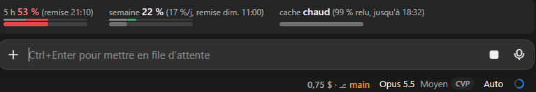

# sonar

*[Version française](README.fr.md)*

A Claude Code **mod** that gives the **Claude Desktop Code tab** what the terminal's *status line* shows —
**without spending a single token**: it reads figures the engine already has and runs `git status` locally.

It does not repeat what Claude Code already shows (context fill, the 5-hour percentage) and shows only what deserves a
glance. Three levels of reading:

**The footer** of the prompt (always shown), between the permission mode and the model name. Short (the app cuts a footer
that is too long with "…"):

```
🔥 $2.40 · ⎇ master
```

In this order, separated by "·", each only when known:

1. the cache state stuck to the session cost: 🔥 warm, ❄️ cold (orange, the next response will rewrite the whole cache),
   ❔ uncertain (orange), then the amount; with the banner on, the cache moves there and the footer keeps the amount only;
2. the branch (`⎇`), shortened: last segment after "/", without a hash suffix, 20 characters at most
   (`claude/mod-pied-cache-79d924` → `mod-pied-cache`); orange on a protected branch; `detached` for a detached HEAD.

The limits (5h, week) are never there, even in alert: they are in the banner, the pane and `/sonar`.
A single warning colour in the footer, orange, on the value (red is kept for the banner and the pane).

**The banner** (`/sonar banner`, optional, on top of the footer) above the prompt: one bar per window and for the cache, all the same height,
each in its own column across the width of the banner (they wrap in a narrow window). For a limit, the bar is
blue up to where usage and time agree, then coloured up to whichever is further: green when time is ahead (room to spare),
orange when usage is ahead (you are using it faster than an even pace), red when, on top of that, the limit is in alert. A reading kept from
another session is drawn faded, usage alone, in blue. The cache bar shows the time it has left, in blood orange, turning
blue over the last 20 % of its lifetime (soon cold). The bar follows the time actually elapsed; the value's colour
allows some slack at the start of a window (1 h of 5 h, 1 day of 7) and also follows the absolute thresholds (70 % and 90 % by
default).
Branch and cost stay in the footer.



*Above (French UI): 53 % of the 5h limit used with just over a quarter of the window elapsed, more than 15 points ahead
→ red (past 5 points it would be orange). In the footer, `main` in orange: protected branch.*

**The pane** (`/sonar`): the full detail, gauges included, with reset times, daily budget, cache hit ratio, branch and
changed files, cost and the usage log file. Close it with its cross. When the pane cannot open, `/sonar` writes that
detail, one line per item:

```
5h limit 23% (resets 15:00)
week 41% (20%/d, resets Fri 13:00)
cache warm (92% reused, until 13:42)
branch feat/x (my-repo, 2 modified)
cost $12.84
```

In the terminal, the banner and the pane are written as text (the terminal draws no gauge). The `hint` and `status`
placements of versions before 0.8.0 are gone: the footer and the banner replace them.

**The sonar extension for Windows and macOS is gone** (removed with mod 0.7.0): since Claude Desktop 6.28899
(November 2026), the app no longer loads an extension through `REACT_PROFILE`. To remove it from a machine where it was
installed, download the repository at its last state ([commit `c86aecb`](https://github.com/Gh0st113/sonar/tree/c86aecb)) and run
`windows\desinstaller.cmd` (Windows) or `sh mac/installer.sh desinstaller` (macOS).

*(Like a ship's sonar: it keeps sounding what lies around you — limits, cache, branch — so you never hit bottom by surprise.)*

License: [MIT](LICENSE).

Nothing is tied to one plan or one person: a figure the engine does not have (usage limits off a subscription,
cost where no ledger is kept) is simply not shown, and thresholds, language, segments and protected branches are plugin options.

## Install

From GitHub:

```sh
claude plugin marketplace add Gh0st113/sonar
claude plugin install sonar@sonar-mods
```

Then `/reload-plugins` in an open session (or start a new one). The line shows up after the first answer:
before it, the engine has measured nothing yet. The mod runs in local sessions: a cloud session does not load it
(it runs in a container that does not have your plugins).

From a local clone (for hacking on it):

```sh
claude plugin marketplace add <path-to-this-repo>
claude plugin install sonar@sonar-mods
```

The mod is then read **from that folder**: after an edit, `/reload-plugins` in the session is enough.

Systems: Windows (desktop app and terminal) and Linux (terminal, tried on Ubuntu); macOS expected, not tried yet
([issue #22](https://github.com/Gh0st113/sonar/issues/22)).

## What is shown

| Item | Source | Footer | Colour |
|---|---|---|---|
| `week` (7-day limit), reset time, daily budget | `session.measure` | never, even in alert | by **pace**: usage compared with the share of the window already elapsed — orange more than `paceWarn` (5) points ahead, red more than `paceAlert` (15) ahead; and orange from `quotaWarn` (70 %), red from `quotaAlert` (90 %) whatever the pace |
| `5h`, reset time | `session.measure` | never, even in alert | orange (red in the banner and pane past `paceAlert`) |
| other limits (e.g. a gateway's `budget`) | `session.measure` | never | absolute thresholds only (no known window length) |
| `cache` warm (hit ratio, when it goes cold), uncertain, cold | last request of the main thread (`turn.step`, subagents excluded); when a session already under way is opened, its last response read from the session's local transcript (see below) | 1st: the icon, stuck to the cost (🔥 warm, ❄️ cold, ❔ uncertain); in the banner when it is on | cold in orange |
| `branch`, repo, changed files | `$.session.repo()` + `git status` (at most every 5 s, 3 s timeout) | 2nd: `⎇` and the shortened name | orange on a protected branch |
| session `cost` estimate (list price) | `session.measure` | 1st, after the cache icon (`🔥 $2.40`); nothing when 0 (new session, or an old one whose cost the engine did not keep) | — |

The mod shows context nowhere: Claude Code already does.

Cache lifetime: inferred from responses (a cache read after more than 6 minutes proves 1 h; a full rewrite points to 5 min),
or told by the engine on a model switch, or forced with `/sonar ttl`. Until it is known, the cache is shown warm for 5 minutes
("at least until"), uncertain up to an hour, then cold.

A session already under way (resumed, app restarted): the mod has not seen any response yet. So on load it reads the
main thread's last response from the local transcript Claude Code keeps for each session
(`~/.claude/projects/<project>/<session id>.jsonl`, or under `CLAUDE_CONFIG_DIR`): its time, its cache usage and the
lifetime it wrote (5 min or 1 h). Read only, no tokens. The time used is when the request was sent if the transcript
records it, else the response time minus one minute (to be safe: the cache counts from the request).

Log over 4 MiB (a very long session: on the author's machine, about one session in five): the engine does not read
such a file. The mod then reads its end with `tail -c` (3 MB, enough to hold the last response), with the same
result as a small log, where `tail` exists (Linux, macOS; Windows only when it is on the PATH). Otherwise, in Claude
Desktop, it takes the last activity time the app keeps in its own record of the session
(`%LOCALAPPDATA%\Claude-Data\claude_*\claude-code-sessions\…\<id>.json`, found through the variables the app hands the
engine), minus the same minute. The time only, no read ratio or lifetime: warm for 5 min "at least", uncertain up to an
hour, then cold. It follows the last response within seconds for most sessions, but activity without a response can
shift it. With neither `tail` nor that record (Windows terminal): the cache stays unknown until the next message.

New session (no response yet): the engine only gives the usage limits with the first response. So the mod keeps the
last reading seen in any session (the % and reset time of `5h` and `week`, in the plugin's local storage, even without
`quotaLog`) and shows it meanwhile, dimmed and as a minimum, since the % only goes up until the reset:
`5h limit ≥ 87% (resets 03:30)`, with its age past one hour (`3h ago, resets 03:30`). A window that has already reset is not
shown; nor is a reading taken under another account (Claude Desktop gives the account to the engine; it is never
shown). The first response brings back the live value.

Open but silent session: its limits date from its last response. If another session of the same account has received
a more recent reading since, it replaces the session's own, window by window, without `≥` or dimming since it was exact
at its time; unless it is lower within the same window (the % only goes up: it is not fresher). Any value read more
than an hour ago carries its age (`5h limit 75% (2h ago, resets 15:00)`), except a window that has already reset. The
session's next response takes over again. Only readings received with a response are kept: the limits the engine
hands back when a session already under way is opened date from its last response, at an unknown time; they show
without an age and give way to any kept reading.

## `/sonar` command (English or French words)

| Command | Effect |
|---|---|
| `/sonar` | opens the detail pane; answers with what is shown (footer, or footer + banner), cache lifetime and help |
| `/sonar banner` (`bandeau`) | adds the banner (limits and cache as gauges) above the prompt; the footer keeps cost and branch |
| `/sonar banner off` (`bandeau off`) | removes the banner: footer only (default) |
| `/sonar ttl 5m` / `1h` / `auto` | prompt cache lifetime; `auto` infers it |
| `/sonar hide` / `show` (`masquer` / `afficher`) | hide footer and banner / bring them back; `/sonar banner` brings them back too |

The banner choice and a forced `ttl` are kept across sessions; a placement chosen before 0.8.0 is carried over
(`banner` → banner on, the others → footer only).

## Options

Set in `settings.json` under `pluginConfigs["sonar@sonar-mods"].options` (the key is `<plugin>@<marketplace>` once installed; or the config menu where the host has one):
`language` (`auto` / `en` / `fr`), `clock` (`auto` / `24h` / `12h`), `banner` (`true`: banner on by default; the old
`placement` option set to `banner` works too), `segments` (comma-separated:
`quotas,cache,repo,cost`), `paceWarn`, `paceAlert`, `quotaWarn`, `quotaAlert`, `protectedBranches`.
An invalid value falls back to its default; `contextWarn`, `contextAlert` and the `context` segment of earlier versions
are ignored.
`language` and `clock` set to `auto` follow the system language: French for `fr`, English elsewhere, 12-hour clock for
`en-US`. When the engine does not know it (on Linux it always answers `en-US`), it is taken from `LC_ALL`, `LC_MESSAGES`
or `LANG` (`C` and `POSIX` do not count).

## Usage limit log (off by default)

To follow your usage limits over time, `quotaLog: true` appends a JSON line to a local file whenever the `5h` or `7d`
percentage — or its reset time — changes. No line when nothing moved, no model call (zero tokens); writing never delays the
display and a disk error is ignored.

```json
{"ts":"2026-10-27T22:42:00.000Z","five_hour":{"pct":66,"resets_at":"2026-10-27T23:00:00Z"},"seven_day":{"pct":67,"resets_at":"2026-11-01T10:00:00Z"}}
```

`pct` is the used percentage as the engine reports it, `resets_at` the reset time in UTC; an unknown window is left out.
The file is `quotaLogPath` (`~/…` accepted), by default `~/.claude/sonar/quota-log.jsonl`; `/sonar` shows the path in use.
Past 3 MiB its content moves to an archive next to it (`quota-log.<date>.jsonl`) and the file starts over.

```json
"pluginConfigs": { "sonar@sonar-mods": { "options": { "quotaLog": true } } }
```

## How it works

A Claude Code plugin in **TypeScript/JSX** (`mod/hooks/register.tsx`), loaded as is by the engine: no npm, no build.

- **Data**: the mod subscribes to engine events — `session.measure` (limits, cost) and `turn.step` (cache usage of each
  request) — and keeps the latest figures in `atom()`s.
- **Display**: `ui.render` hooks on the app's slots — `SessionMode` (footer), `AbovePrompt` (banner), `Pane` (pane) —
  return JSX built from components the app provides (`Box`, `Text`, `Svg` for the gauges). In the terminal there is no
  `Svg`: the same content comes out as text.
- **Pure logic** (pace, thresholds, texts) in `mod/hooks/logique.mjs`, tested on its own.

## Tests

```sh
node --test mod/test/
claude plugin validate mod
claude plugin test mod
```

GitHub Actions runs the mod logic tests on every push.

## Credits and sources

- **[UI+ for Claude](https://github.com/LukasvanUden/ui-plus-for-claude)**, by Lukas van Uden (Windows support by
  DarkstarDEV), MIT licence: the gauges' time line takes its idea and colours. Up to 0.7.0, the sonar extension for Windows reused
  its code; files taken, licence and audit: `windows/PROVENANCE.md` (in French) at
  [commit `c86aecb`](https://github.com/Gh0st113/sonar/tree/c86aecb).
